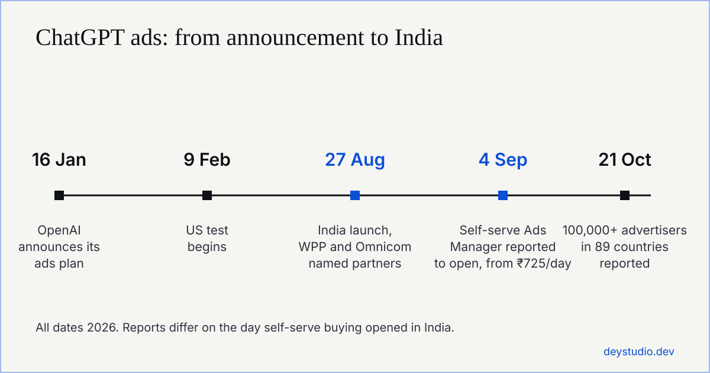
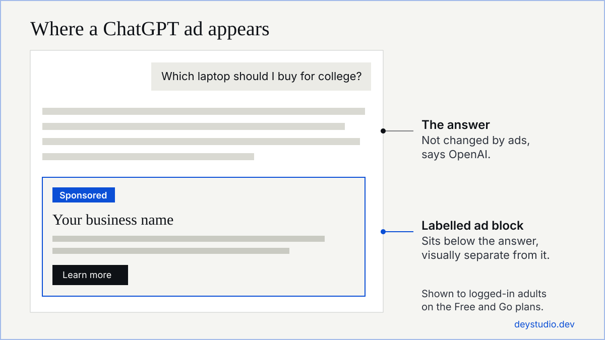

A ChatGPT ads agency in India plans, launches and measures paid ads that appear inside ChatGPT. The ads are labelled as sponsored, sit below an answer, and are shown to logged-in adults on the Free and Go plans. Indian businesses can start from ₹725 a day, so you can test the channel yourself in OpenAI's Ads Manager or hire an agency to run it for you.

OpenAI announced ChatGPT ads for India on 27 August 2026. India is its second-largest market by weekly users, with more than 100 million people using ChatGPT each week. This guide covers what the ads cost, who is allowed to run them, how targeting and bidding work, and how to tell an agency that knows the channel from one that is repeating launch headlines.

## Quick answer

- What it is: sponsored placements shown below ChatGPT answers, bought through OpenAI's Ads Manager, its ads team or an agency.
- Who sees them: logged-in adults on the Free and Go plans.
- Cost: from ₹725 a day for rupee-billed accounts, which is about ₹21,750 over 30 days before any agency fee.
- Who cannot advertise: alcohol, tobacco, gambling and political content are barred everywhere. Outside the US, financial, health and legal services ads are generally prohibited.
- Do you need an agency: not for a small test. An agency helps with tracking, landing pages, creative and comparing channels.
- Early evidence: US data reported by Search Engine Journal shows ChatGPT ad visits earned far less revenue per visit than Google search ads, so test small and measure.

## ChatGPT ads in India at a glance

| Question | Answer |
| --- | --- |
| When did ChatGPT ads launch in India? | Announced on 27 August 2026 |
| Who sees the ads? | Logged-in adults on the Free and Go plans |
| Who does not see them? | Plus, Pro, Business, Enterprise and Education subscribers, and under-18 accounts |
| Where do ads appear? | Below the answer, labelled as sponsored |
| Minimum budget | ₹725 a day, billed in rupees |
| How do you buy? | Self-serve Ads Manager, OpenAI's ads team, or an agency |
| First agency partners | WPP and Omnicom (OpenAI says the agency model is non-exclusive) |
| Buying goals | Views (per 1,000 impressions), clicks (per click) and conversions |

Launch reports disagree on one detail. Several outlets said self-serve buying would open on 4 September. PPC Land reported that Indian advertisers had no self-serve access at launch. OpenAI's current Ads Manager documentation, as summarised by eCorpIT, lists India as a self-serve market with the ₹725 minimum.

## What is a ChatGPT ads agency?

A ChatGPT ads agency is a marketing or PPC agency that buys and manages OpenAI's sponsored placements for clients. It works in the same way a Google Ads agency does, but on a newer channel with different targeting and fewer reporting tools.

### What a ChatGPT ads agency does

An agency handles the work between your budget and the ad. In practice that means choosing the conversation topics you want to appear beside, writing the ad text and creative, building or fixing the landing page, setting up conversion tracking, watching spend, and reporting what each enquiry or sale cost.

### What no agency can sell you

No agency can sell you a place inside ChatGPT's answers. OpenAI says ads do not influence what ChatGPT replies, and the ad sits in its own block under the answer. If someone promises to get your brand recommended by ChatGPT for a fee, that is organic visibility work, sometimes called generative engine optimization (GEO) or answer engine optimization (AEO). It is a different service from advertising.

## How do ChatGPT ads work in India?

### Where the ads appear

Ads are shown to logged-in adults on the Free and Go plans, as a labelled sponsored block below an answer. OpenAI excludes under-18 accounts and sensitive topics. A US report found that most ChatGPT ads in beauty and travel ran on research-style prompts, which suggests the format suits people who are comparing options.

### Targeting by conversation context

You do not bid on a keyword list the way you do in Google Ads. Targeting follows the topic of the conversation, and you give the system hints about the subjects you want to appear next to.

### Buying goals and bidding

You pick a goal: views, clicks or conversions. Search Engine Journal reported on 10 November that ChatGPT Ads is replacing manual max bid and max CPC settings with average cost targets, with different rollout dates for new campaigns, existing campaigns and API partners. It also reported that creative enhancements are now switched on by default, so check your settings and opt out if you want to control the wording of your ads.

### Conversion tracking and measurement

Tracking runs through a pixel or a Conversions API, so your website needs to be set up to report sales or enquiries back to the ad platform. Without it you can see clicks but not results.

## How much do ChatGPT ads cost in India?

### The minimum budget

The minimum is ₹725 a day for accounts billed in rupees. At that floor you would spend about ₹5,075 a week, or ₹21,750 over 30 days, before any agency fee.

### How daily budgets are paced

Daily budgets are averaged over a Sunday to Saturday week, so one day can run above your daily figure. Set a weekly limit you can afford instead of relying on the daily number alone.

### Cost per click and cost per enquiry

We are not quoting a cost per click or a cost per enquiry. There is no reliable public benchmark for India yet. The channel has been live here for a few months, and the numbers some agencies publish come from a handful of campaigns. In the US, Search Engine Journal reported that ChatGPT ad visits brought far less revenue per visit than Google search ad visits, and that most advertisers saw no sales from them. Test with a small budget and measure your own cost per enquiry.

### Agency fees

An agency fee is separate from ad spend. Ask for it as a fixed amount in writing.

## Which businesses cannot advertise on ChatGPT in India?

### Restricted and banned categories

OpenAI's policies, as summarised by independent write-ups, rule out alcohol, tobacco, gambling, political content, recreational drugs and adult content everywhere. Outside the US, ads for financial services, health services and legal services are generally prohibited as well. Banks, insurers, hospitals and law firms in India should not plan a campaign on this channel for now.

### Indian advertising rules

The ASCI Code and the Central Consumer Protection Authority's guidelines on misleading ads cover ChatGPT ads like any other medium. Policies change quickly, so read OpenAI's current ad policy before you commit budget.

## Should you run ChatGPT ads yourself or hire an agency?

Self-serve buying is open in India and no agency relationship is required, so a small test is something you can run alone. An agency earns its fee when the work around the ad is the hard part.

| Your situation | Better fit |
| --- | --- |
| One product, one landing page, a budget near the minimum | Run it yourself |
| No conversion tracking on your website yet | A developer or agency, before any spend |
| A slow or unclear landing page | Fix the page first |
| Google, Facebook and ChatGPT ads at the same time | An agency, so one team compares the results |
| A borderline or regulated category | An agency, to check policy before you spend |

## How do you choose a ChatGPT ads agency in India?

1. Ask how they buy. Self-serve is open, so special access is not a reason to pay more.
2. Check partner claims. OpenAI named WPP and Omnicom as its first India agency partners. If an agency says it is an official partner, ask for proof.
3. Be careful with big numbers. The channel reached India in August 2026, so claims of hundreds of ChatGPT campaigns or years of experience on it need evidence.
4. Ask to see a live account with dates, spend and sample size, not a screenshot of a percentage.
5. Keep the ad account and billing in your own name, so you can leave without losing your data.
6. Ask who sets up tracking and when. It should be done before the first rupee is spent.
7. Get a fixed fee in writing. Nobody can honestly promise a number of customers.
8. Ask them to tell you if your industry is not allowed. A good agency says no before it takes your money.

## How do you start a ChatGPT ads test?

1. Pick one product or service and one landing page. Make sure the page loads fast on a phone and has one clear action.
2. Install conversion tracking and check that a test enquiry shows up.
3. Set a daily budget at or near ₹725 and a weekly limit you are comfortable losing.
4. Run it for two weeks, then compare your cost per enquiry with what you pay on Google Ads or Facebook.
5. Put more money only into what returns more than it costs.

## ChatGPT ads compared with other channels

### ChatGPT ads or Google Ads first?

Start with Google Ads if you sell something people already search for by name, because search captures demand that exists. ChatGPT ads are worth a small test when your customers ask long, specific questions before they buy, such as comparing options or planning a purchase. Google is also adding ads to its AI search: Search Engine Journal reported on 10 November that English-language ads in AI Mode are expanding to more than 10 new countries, and AI Mode ads began scaling in India on 28 October 2026.

### Paid ads or organic AI visibility?

A paid placement buys attention under an answer. Organic visibility, which means being cited or recommended inside the answer, comes from clear pages, consistent business details across the web, and reviews and listings on other sites. Many businesses need both, and the landing page decides how many clicks become enquiries. Our guide on [why a website gets visitors but no customers](/articles/why-your-website-gets-no-customers/) covers the fixes that matter most.

## How Dey Studio can help

We build websites and online shops and run Google, Facebook and ChatGPT ads for small businesses in India and abroad. Every client gets a fixed price in writing before work starts. If you are in West Bengal, see our page on [web development in Kolkata](/web-development-company-kolkata/), or read our guide to a [website for a restaurant in Kolkata](/articles/website-for-restaurant-kolkata/). Send us your website and what you sell, and we will tell you whether ChatGPT ads fit your business yet.

## Frequently asked questions

### What is a ChatGPT ads agency?

A ChatGPT ads agency sets up, runs and measures paid ads that appear in ChatGPT. It writes the ad, picks the topics to appear beside, builds the landing page, sets up tracking and reports the results. It cannot change ChatGPT's answers.

### Can Indian businesses advertise on ChatGPT?

Yes. OpenAI launched ChatGPT ads in India on 27 August 2026. Businesses can buy through the self-serve Ads Manager, through OpenAI's ads team, or through an agency. WPP and Omnicom were named as the first agency partners.

### How much do ChatGPT ads cost in India?

The minimum daily budget is ₹725 for rupee-billed accounts, which is about ₹21,750 over 30 days. Pricing is per 1,000 impressions or per click depending on your goal. Agency fees are extra and vary, so ask for a fixed quote.

### Who sees ChatGPT ads in India?

Logged-in adults on the Free and Go plans. Plus, Pro, Business, Enterprise and Education subscribers do not see ads, and OpenAI excludes under-18 accounts and sensitive topics.

### Do ads change ChatGPT's answers?

No, according to OpenAI. Ads sit in a labelled block below the answer and do not influence what ChatGPT says. Paying for an ad does not make ChatGPT recommend your brand in its answer.

### Which businesses cannot run ChatGPT ads in India?

Alcohol, tobacco, gambling, political content, recreational drugs and adult content are barred everywhere. Outside the US, financial, health and legal services ads are generally prohibited. Check OpenAI's current ad policy before planning a campaign.

### Do I need an agency to run ChatGPT ads?

No. Self-serve buying is open, so you can run a small test yourself. An agency helps when you need tracking, landing pages, creative or a comparison across several ad channels.

### Are ChatGPT ads worth it compared with Google Ads?

It is too early to say for India. US data reported by Search Engine Journal shows ChatGPT ad visits earned far less revenue per visit than Google search ads, and most advertisers saw no sales. Run a small test with tracking and compare your own cost per enquiry.

### What is the difference between ChatGPT ads and GEO?

ChatGPT ads are paid placements below an answer. GEO, or generative engine optimization, is the work of earning mentions and citations inside AI answers without paying per click. They solve different problems and can be used together.

### How do I get started with Dey Studio?

Message us on WhatsApp or email with your website and what you sell. We reply with a fixed quote and a start date.

This guide was last checked on 13 November 2026. ChatGPT ads are new and the rules are changing, so confirm current details with OpenAI before you spend.

- [OpenAI rolls out ChatGPT Ads in India, exchange4media](https://www.exchange4media.com/digital-news/openai-rolls-out-chatgpt-ads-in-india-157677.html)
- [OpenAI launches ChatGPT Ads in India, Analytics India Magazine](https://analyticsindiamag.com/ai-news/openai-launches-chatgpt-ads-in-india)
- [ChatGPT ads arrive in India, Business Today](https://www.businesstoday.in/technology/artificial-intelligence/story/chatgpt-ads-arrive-in-india-as-openai-targets-free-go-users-in-major-revenue-push-ahead-of-ipo-551655-2026-08-27)
- [OpenAI brings ChatGPT ads to India, Outlook](https://respawn.outlookindia.com/pop-culture/pop-culture-news/openai-brings-chatgpt-ads-to-india)
- [OpenAI gains 32 ChatGPT ad markets in 5 days as India goes live, PPC Land](https://ppc.land/openai-gains-32-chatgpt-ad-markets-in-5-days-as-india-goes-live/)
- [ChatGPT ads in India: what's live and how to test, eCorpIT](https://ecorpit.com/chatgpt-ads-india-2027/)
- [Paid media news (ChatGPT Ads cost targets, creative defaults, US revenue-per-visit data), Search Engine Journal](https://www.searchenginejournal.com/category/paid-media/)
