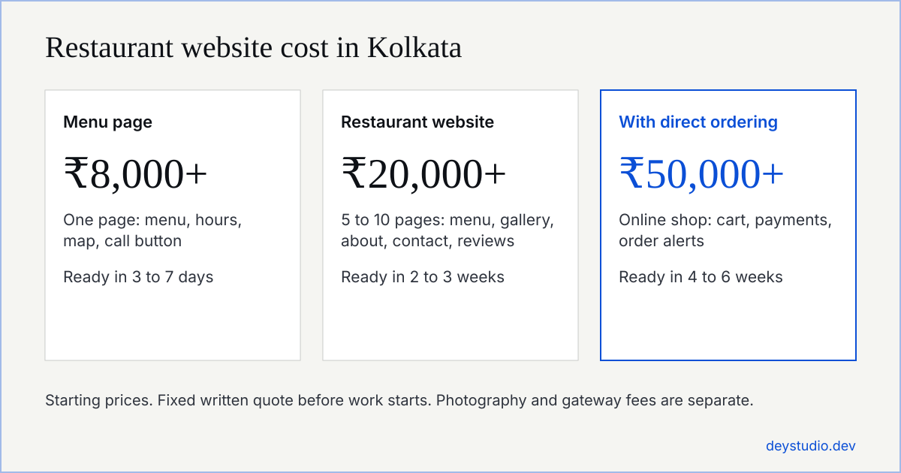
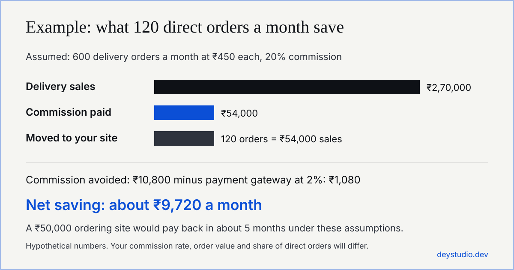

A website for a restaurant in Kolkata should show your menu with prices, your address, opening hours, a Google Maps link, real photos and one clear way to order or book a table. Restaurant web design starts at about ₹8,000 for a one-page menu site, ₹20,000 for a full restaurant website, and ₹50,000 for a site with direct online ordering.

This guide covers what to put on the site, what restaurant website development costs, how direct orders compare with Zomato and Swiggy commissions, and how to get found in local search. It is written for owners of restaurants, cafés, cloud kitchens, bakeries and sweet shops in Kolkata.

## Quick answer

- Cost: ₹8,000 for a menu page, ₹20,000 for a 5 to 10 page restaurant website, ₹50,000 for a website with online ordering and payments. Maintenance starts at ₹2,000 a month.
- Must include: a text menu with prices, address and opening hours, a map, tap-to-call and WhatsApp buttons, real photos, and a table booking or ordering option.
- Savings: Zomato and Swiggy commissions are reported at roughly 16% to 30% of each order. Orders placed on your own site avoid that commission and pay only the payment gateway fee.
- Visibility: a complete Google Business Profile, a fast mobile site, menu text on the page and Restaurant structured data matter most for local search.
- Time: 3 to 7 days for a menu page, 2 to 3 weeks for a restaurant website, 4 to 6 weeks with ordering.

## What should a restaurant website include?

Many diners look a restaurant up on their phone before they visit. They want the same few answers fast, so the website should give them without a search.

### A digital menu written as text

Put the menu on the page as text, with prices, categories and dish descriptions. A PDF or a photo of a printed card loads slowly on mobile and Google reads it poorly. Text also lets you rank for dish names such as biryani, kosha mangsho, chingri malai curry or rolls.

### Address, opening hours and Google Maps link

Show your full address, the neighbourhood (Park Street, Gariahat, Ballygunge, Salt Lake or New Town, for example), opening hours and an embedded map. Update festival hours, because timings often change around Durga Puja and other holidays.

### Call, WhatsApp and table booking buttons

Place a tap-to-call button and a WhatsApp Business link at the top of every page. If you take reservations, add a simple booking form. If you do not, say how to book.

### Photos and trust signals

Use real photos of your dishes and dining room. Add customer reviews with a link to your Google listing, and show your FSSAI licence number in the footer.

### Bengali and English content

If your regulars read Bengali, offer the menu in both Bengali and English. It costs little and makes the site easier to use.

## How much does a restaurant website cost in Kolkata?

Published restaurant web design prices vary widely. Indian agencies list anything from ₹15,000 for a basic site to more than ₹4 lakh for a custom build with ordering, reservations and chatbots. Most single-outlet restaurants do not need the top end.

### Restaurant website price tiers

| What you get | Starting price | Typical time |
| --- | --- | --- |
| One-page menu site with hours, map and call button | ₹8,000 | 3 to 7 days |
| Restaurant website of 5 to 10 pages with gallery and reviews | ₹20,000 | 2 to 3 weeks |
| Website with direct online ordering and payments | ₹50,000 | 4 to 6 weeks |
| Monthly maintenance: updates, backups, security, small changes | ₹2,000 a month | Ongoing |

### What changes the price

The number of pages, whether you need an online ordering system, how many menu items you have, whether you need table reservations, and how much content and photography you supply. Custom features such as loyalty offers, multiple outlets or delivery tracking raise the cost.

### Costs to ask about before you sign

Ask every agency for these as separate lines in writing:

- the domain name and hosting, per year
- the payment gateway fee, charged on each online payment
- food photography, if you do not have your own photos
- who owns the domain, the website files and your customer data

We give a fixed quote in writing before work starts. If the price in a page title differs from the price in the page body, ask which one you will be billed.

## Menu website, online ordering or app?

The right choice depends on where your sales come from today.

| Your situation | What fits |
| --- | --- |
| Dine-in restaurant that wants more walk-ins and bookings | Menu website with a map, photos, reservation or WhatsApp button |
| You sell mostly through Zomato or Swiggy and want to reduce fees | Website with direct ordering, keeping your app listings |
| Cloud kitchen with no dining room | Ordering website, since you have no walk-in traffic to rely on |
| New restaurant, tight budget | Menu page first, add ordering once you have regular customers |

### QR code menus

A QR code on the table or the packaging can open your web menu, so you can change prices without reprinting. The QR code should lead to a fast page on your own domain.

### WhatsApp ordering

WhatsApp ordering is a low-cost start. Customers message an order and you confirm it. It works for small volumes, but it has no cart, no payment step and no order history, which is why busy kitchens move to a proper ordering system.

### Online payments with UPI and cards

A payment gateway lets customers pay by UPI, cards and wallets on your site. It charges a fee on each payment, so ask for the rate before you choose one.

## Direct ordering versus Zomato and Swiggy

### What the apps charge

Reports put Zomato and Swiggy commissions at roughly 16% to 30% of the order value. A Bengaluru restaurant association has cited a range of 8% to 28%, plus advertising and payment fees. Your own rate depends on your contract, so check your latest statement.

### A worked example

Orders placed on your own site avoid that commission. You still pay the payment gateway, which commonly takes around 2% of each online payment.

With 600 delivery orders a month at ₹450 each, sales are ₹2,70,000. At 20% commission you pay ₹54,000. If 120 of those orders come through your own site, you avoid ₹10,800 in commission and pay about ₹1,080 in gateway fees, a net saving of roughly ₹9,720 a month. A ₹50,000 ordering site would pay back in about five months under these assumptions. These numbers are an example, not a promise. Your order volume and the share of customers who switch will decide the real figure.

### How to move regulars to direct orders

Do not delist from the apps on day one. They bring you new customers who have never heard of you. Stay listed, then give regulars a reason to order direct: a small discount, a free item, or a QR code on the packaging that leads to your ordering page.

## How does a restaurant website get found in Kolkata?

A new website will not outrank Zomato for "best restaurants in Kolkata". It can rank for your own name, your neighbourhood and your specific dishes.

### Google Business Profile

Claim and complete your Google Business Profile. For "restaurants near me" searches and Google Maps results, it matters as much as your website. Add photos, hours, your menu link and your phone number.

### Keywords customers search

Customers search by dish, cuisine and area, such as "biryani near Park Street", "Bengali restaurant in Salt Lake" or "café in New Town". Use these phrases naturally in your menu, page headings and about text. Keep your name, address and phone number identical on your website, Google, Zomato and Swiggy.

### Restaurant structured data

Ask your developer to add Restaurant schema markup with your cuisine, price range, opening hours, address and menu link. It helps Google and AI answers read your details correctly.

### Reviews and replies

Ask happy customers for Google reviews and reply to every review, good or bad.

### Page speed and mobile layout

Compress photos, avoid heavy sliders and test on mobile data. A mobile-friendly site that loads in a few seconds keeps visitors long enough to read the menu.

### AI search

ChatGPT and Google's AI answers pull from pages that state facts clearly, and from reviews and listings on other sites. A complete Google profile and consistent details across the web help there too. No one can promise a position, and results take weeks or months.

## What different food businesses in Kolkata need

### Dine-in restaurants and cafés

A menu, photos, location, opening hours and a booking or WhatsApp button. Add ordering later if delivery grows.

### Cloud kitchens and delivery-first brands

An online ordering website with delivery areas, minimum order values, payments and order alerts. Your site is your main storefront, so speed and checkout matter most.

### Bakeries, sweet shops and caterers

A catalogue with photos and prices, an advance-order or enquiry form for festivals and events, and a clear lead time. A mishti shop or caterer often wins orders through enquiries, so a simple form and WhatsApp button can work better than a full cart.

## What do Kolkata restaurants often get wrong?

- Special hours are not updated for festival days.
- The menu is a photo of a printed card, so it cannot be searched or read easily on a phone.
- There is no click-to-call button, so customers have to copy the number.
- The ordering page sends the customer to a third-party app instead of taking the order itself.
- The name, address or phone number differs between the website and the Google listing.

## Restaurant website launch checklist

1. Menu with current prices, live on the page as text.
2. Address, hours, festival hours and map link are correct.
3. Call and WhatsApp buttons work on a real phone.
4. A test order and a test payment go through, and you receive the alert.
5. Google Business Profile links to the site.
6. FSSAI number, privacy notice and refund or cancellation terms are in the footer.
7. Pages load in a few seconds on mobile data.
8. You can update the menu yourself, or you know who does it and how long it takes.

## How Dey Studio can help

We build restaurant websites and online shops for businesses in Kolkata and across India, on WordPress and WooCommerce, Shopify or a fast static site, from a one-page menu site to a site with direct ordering. We can also run Google and Facebook ads once the site is live. See our page on [web development in Kolkata](/web-development-company-kolkata/) for prices and process, and our guide on [why a business website gets visitors but no customers](/articles/why-your-website-gets-no-customers/) for the fixes that matter most. If you are weighing a new ad channel, read our guide to [ChatGPT ads for Indian businesses](/articles/chatgpt-ads-agency-india/).

Send us your menu, your location and what you want the site to do, and we will reply with a fixed quote and a start date.

## Frequently asked questions

### How much does a website for a restaurant in Kolkata cost?

A one-page menu site starts at ₹8,000, a restaurant website of 5 to 10 pages at ₹20,000, and a site with direct online ordering at ₹50,000. Domain, hosting, payment gateway fees and food photography can be extra. Get a fixed quote in writing.

### How long does it take to build a restaurant website?

A one-page menu site takes about 3 to 7 days, a full restaurant website 2 to 3 weeks, and a site with ordering and payments 4 to 6 weeks. Delays usually come from waiting for photos, menu text and approvals.

### Does my restaurant need online ordering?

Not always. A dine-in restaurant often does well with a menu, photos, map and a booking or WhatsApp button. Online ordering makes sense if you sell a lot through delivery apps and want to reduce commission, or if you run a cloud kitchen.

### How much commission do Zomato and Swiggy charge?

Reports put commissions at roughly 16% to 30% of the order value, and one Bengaluru restaurant association cites 8% to 28% plus advertising and payment fees. Your rate depends on your contract, so check your own statement.

### Do I need a website if I have a Google listing and Instagram?

A Google Business Profile helps people find you, and Instagram shows your food. A website adds a full searchable menu, direct ordering and booking, and data you own. It also gives Google and AI tools one reliable page about your restaurant.

### Do I need a QR code menu?

It is useful if you change prices often or want to cut printing costs. The QR code should open a fast menu page on your own domain, so it also helps your website rank.

### Can I update the menu myself?

Yes, if the site is built with an editor you can use, and you should ask for this before you sign. Otherwise ask how quickly the developer makes changes. Monthly maintenance from us starts at ₹2,000 and covers small changes.

### Will my restaurant website show up on Google?

It can rank for your restaurant name, your neighbourhood and your dishes. For searches like restaurants near me, your Google Business Profile matters as much as the website. Rankings take weeks or months and nobody can honestly promise a position.

### Should I leave Zomato and Swiggy once I have a website?

Many restaurants stay listed, because the apps bring new customers. Use your website for regulars and repeat orders, so more of your sales come without commission.

### Do you build restaurant websites outside Kolkata?

Yes. We work with clients across India and abroad by WhatsApp, video call and email, and our offices are listed in Kolkata and Moscow.

## Sources

Prices for Dey Studio are our own starting prices. Commission figures are reported ranges and change with each contract. Last checked on 13 November 2026.

- [Why Bengaluru restaurants are threatening to boycott Zomato and Swiggy, The Week](https://www.theweek.in/news/biz-tech/2026/07/30/wont-take-orders-anymore-why-bengaluru-restaurants-are-threatening-to-boycott-zomato-swiggy.amp.html)
- [Rapido slashes food delivery charges to counter Zomato and Swiggy, CIO Insider](https://www.cioinsiderindia.com/news/rapido-slashes-food-delivery-charges-by-half-to-counter-zomato-swiggy-nwid-7249.html)
- [Reduce Zomato and Swiggy commission, DineOpen (payment gateway fee of 1.5% to 2%)](https://www.dineopen.com/blog/reduce-zomato-swiggy-commission-restaurants.html)
- [Restaurant website cost India, ColorWhistle](https://colorwhistle.com/website-cost-features/restaurant-website-cost-india/)
- [Restaurant and cafe website design in Kolkata, Codingclave](https://codingclave.com/website-for/restaurant-cafe-in-kolkata)
